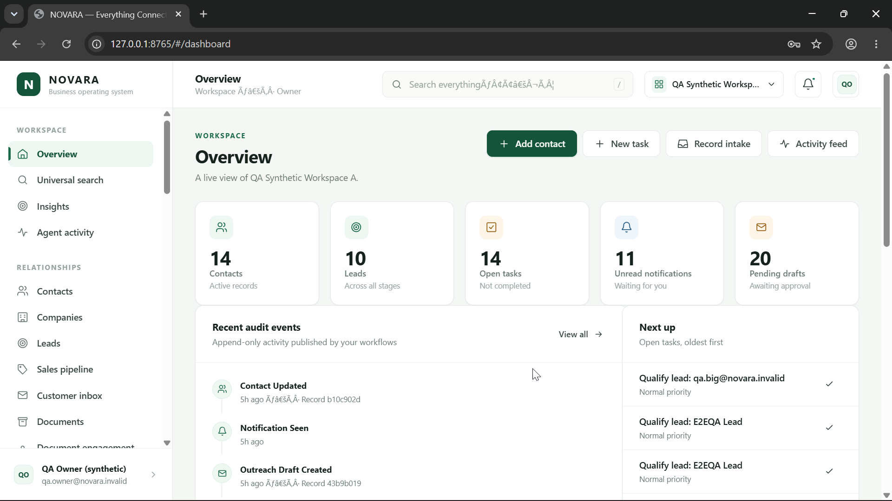
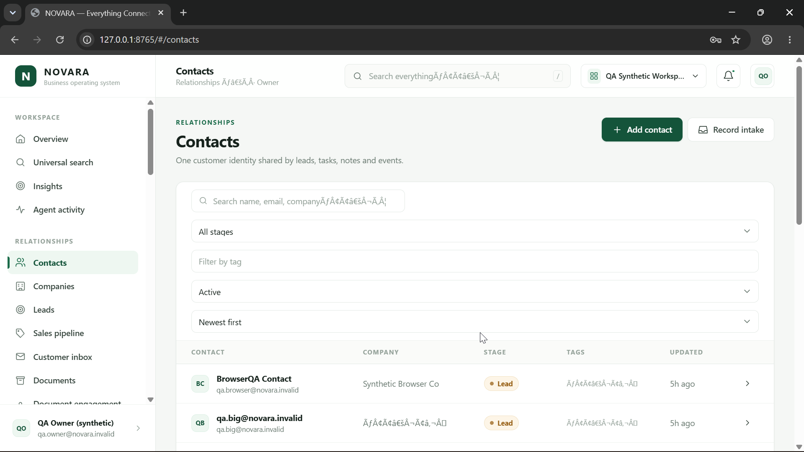
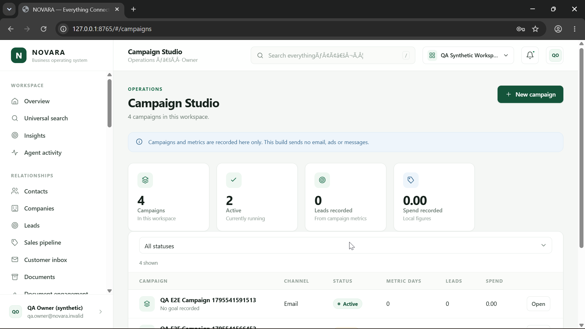

<div align="center">
  
  <h1>NOVARA</h1>
  <p><strong>Everything Connected. Everything Under Control.</strong></p>
  <p>
    <a href="https://ganeshkrishnareddy.github.io/novara/">Project site</a> ·
    <a href="https://github.com/ganeshkrishnareddy/novara/releases/tag/v0.1.0-desktop-ci-preview">Desktop CI preview</a> ·
    <a href="https://github.com/ganeshkrishnareddy/novara/actions/workflows/desktop-build.yml">Build workflow</a>
  </p>
</div>

---

## At a glance

| | |
| --- | --- |
| Project | A self-hostable business operating system built as one connected application |
| Stage | Active development; not a release candidate |
| Default install | Python 3.11+ and SQLite; no hosted account, Docker, Redis or API key |
| Verified locally | Backend suite, browser walkthrough, end-to-end workflows and a Windows desktop preview |
| Not yet verified | Linux/macOS installers, signed binaries, container builds, live PostgreSQL and provider integrations |
| Repository licence | Pending owner decision |

## The idea

Businesses accumulate one tool per job: a CRM here, campaigns there, support in another inbox, projects somewhere else. Each system holds part of the customer and none sees the whole journey.

NOVARA replaces that fragmentation with a shared customer identity, workspace and permission model, append-only event spine, and analytics stream. CRM, sales, marketing, support, feedback, projects, documents, automation and governed local agents are separate capability modules on one foundation — not ten products linked by hand.

## What works today

- **Foundation:** first-run setup, registration, login/logout, bcrypt hashing with SHA-256 pre-hash, revocable sessions, refresh rotation, password reset, workspace membership and invitations, seven workspace roles, and server-side cross-workspace denial.
- **One customer record:** contacts, companies, notes, lead lifecycle, tasks, notifications, audit events and a unified customer timeline driven by one local event log.
- **Capability modules:** CRM, lead intelligence, sales, marketing, support, feedback, analytics and experimentation, search, projects, documents and data rooms, notifications, automation, integrations and a governed agent centre.
- **Connected workflow:** website form → contact → lead → task → notification → outreach draft → authorised approval → audit trail.
- **Approval-gated marketing run:** audience → campaign → approval → local delivery trace → analytics, with consent, suppression and DNC rechecked at execution time. Nothing is sent outside the machine.
- **Developer surface:** FastAPI with generated OpenAPI documentation, SQLAlchemy models, Alembic migrations (single head `b5c6d7e8f9a0`) and a documented module contract.

External providers are deliberately not wired in. Provider-backed features stay blocked until a real provider is configured and verified; no delivery is presented as successful when it was not.

## Architecture

```text
                 workspace + server-side permissions
                                  │
     contact · company · lead · task · document · experiment
                                  │
                                  ▼
                     append-only event spine
                                  │
        notifications · audit log · customer timeline · local jobs
                                  │
                                  ▼
          draft → human approval → local trace/audit event
                    (no external send endpoint)
```

Every authenticated endpoint resolves identity on the server, checks workspace membership and filters by `workspace_id`. Modules own their tables and event types; shared core files are not edited by module work. See [MODULE_CONTRACT.md](docs/architecture/MODULE_CONTRACT.md) and [CONTRACTS.md](docs/architecture/CONTRACTS.md).

## Quick start

Requires Python 3.11 or newer (3.12 recommended) and a modern browser.

```powershell
# Windows PowerShell
.\scripts\start-local.ps1
```

```sh
# macOS / Linux / Termux
sh scripts/start-local.sh
```

Both scripts create a local virtual environment, install the project in editable mode and start the API at <http://localhost:8000>. Complete first-run setup there; interactive API documentation is at <http://localhost:8000/docs>. A SQLite file is created in the project folder, and neither a licence key nor a hosted account is needed. See [INSTALL.md](docs/INSTALL.md) for manual steps and troubleshooting.

To run the backend suite:

```sh
python -m pip install -e "./apps/api[dev]"
python -m pytest apps/api/tests -q
```

## Verification

Results below are recorded in the repository, not estimates. A rendered route or a 200 response is not treated as feature acceptance.

| Check | Recorded outcome | Evidence |
| --- | --- | --- |
| Backend suite | 1,641 passed, 4 warnings, exit 0 | [full suite log](docs/evidence/t131-fullsuite-clean-20261124.txt) |
| Feature catalogue | 1,488 rows: 1,418 verified complete, 70 compatible replacements, 0 not-implemented | [completion dashboard](docs/FEATURE_PARITY/COMPLETION_DASHBOARD.md) |
| API surface | 293 checks passed under recorded expectations | [final QA report](docs/QA/MASTER_QA_REPORT.md) |
| End-to-end flows | 61 records: 52 pass, 9 informational, 0 fail | [workflow results](docs/QA/END_TO_END_WORKFLOW_RESULTS.md) |
| Security / negative checks | 17 of 17 passed under recorded expectations | [security results](docs/QA/SECURITY_TEST_RESULTS.md) |
| Browser UI | 50 configured module routes rendered | [final QA report](docs/QA/MASTER_QA_REPORT.md) |

Migration head, test commands and earlier runs are in [TEST_RESULTS.md](docs/TEST_RESULTS.md). Remaining QA limitations are listed in [KNOWN_LIMITATIONS.md](docs/QA/KNOWN_LIMITATIONS.md).

## Repository layout

| Path | Contents |
| --- | --- |
| `apps/api/` | FastAPI application, capability modules, models, migrations and tests |
| `apps/web/` | Vanilla JavaScript light-theme web client |
| `desktop/` | Electron shell, native build payloads and desktop documentation |
| `site/` | Public marketing portal prepared for GitHub Pages |
| `scripts/` | Local start, QA and maintenance scripts |
| `docs/` | Architecture, status, QA evidence, licensing and release documentation |
| `artifacts/` | Local QA evidence: screenshots, recordings, logs and verification files |
| `deliverables/` | Reference website deliverable prepared during research |

Browser-profile caches, local databases and generated worktree copies are deliberately excluded from the repository.

## Desktop preview

The `desktop/` folder contains an Electron shell that starts the bundled backend and serves the existing web client from one process. `.github/workflows/desktop-build.yml` defines a four-leg native matrix — Windows x64, Linux x64, macOS x64 and macOS arm64 — with backend checks, payload smoke tests, checksums, manifests and run-scoped artifact uploads.

A Windows x64 installer was built and install-tested locally. Linux and macOS artifacts are CI-configured only: no successful runner result or checksum exists for them yet. The native CI scope is identified by the [v0.1.0-desktop-ci-preview](https://github.com/ganeshkrishnareddy/novara/releases/tag/v0.1.0-desktop-ci-preview) prerelease from commit `c6e68da`. It is unsigned, attaches no binaries and is not a production release.

## Documentation

- [Project site](https://ganeshkrishnareddy.github.io/novara/) — product overview, workflows, FAQ and install guidance
- [Project status](docs/PROJECT_STATUS.md) — phase-by-phase implementation state
- [Test results](docs/TEST_RESULTS.md) — commands actually run and their outcomes
- [Blockers and decisions](docs/BLOCKERS.md) — what remains open
- [Native CI preparation review](docs/DESKTOP_RELEASE/CI_NATIVE_PREP_REVIEW.md) — desktop build scope and gates
- [Deployment runbook](docs/DEPLOYMENT_RUNBOOK.md) and [known limitations](docs/QA/KNOWN_LIMITATIONS.md)
- [Website claims audit](docs/WEBSITE_CONTENT_CLAIMS_AUDIT.md) — how public claims are checked against evidence

## Screenshots and demo

Screenshots are genuine local QA captures using synthetic records.

[](artifacts/final_qa_2026-11-24/screenshots/01_dashboard.png)
[](artifacts/final_qa_2026-11-24/screenshots/02_contacts.png)
[](artifacts/final_qa_2026-11-24/screenshots/04_campaign_studio.png)

Three MP4 recordings were made from the running application with synthetic data: [Product Demo 2.0](artifacts/demo_v2_work/videos/NOVARA_Product_Demo_2.0.mp4), [Product Demo 1.0](artifacts/final_qa_2026-11-24/videos/NOVARA_Product_Demo_1.0.mp4) and the [QA evidence walkthrough](artifacts/final_qa_2026-11-24/videos/NOVARA_Complete_QA_Walkthrough.mp4). Chapter timings are in [VIDEO_CHAPTER_INDEX.md](docs/QA/VIDEO_CHAPTER_INDEX.md). These recordings demonstrate observed local actions, not per-feature acceptance or real customer activity.

## Security and privacy

Report vulnerabilities privately via [SECURITY_REPORT.md](docs/SECURITY_REPORT.md). Verified controls include server-side identity, workspace isolation, bcrypt hashing, hashed random tokens, refresh rotation, revocable sessions, permission checks in the dependency layer and an append-only audit log. The QA pass recorded 17 of 17 negative checks passing; this is smoke-level evidence, not a penetration test or a finished audit. No login rate limiting in the audited build, unverified email ownership, dependency/secret scanning and live PostgreSQL RLS remain open. Do not treat this build as secure for a networked deployment until those gaps close.

The prepared static site has no analytics, tracking pixels, cookies, third-party scripts or secrets and makes no external requests. That is a local preparation fact, not a certification.

## Known boundaries

NOVARA is not production-ready. There is no hosted service, native mobile installer, managed backup, signed binary or outbound notification delivery in this build. Container builds, a live PostgreSQL server, non-Chromium browsers and provider credentials are unverified. The repository licence is an owner decision, so this code should be described as an open-source foundation subject to final licensing review — not as an openly licensed release.

## Licence and attribution

Upstream licence review is complete: see [LICENSE_COMPLIANCE.md](docs/research/LICENSE_COMPLIANCE.md) and [THIRD_PARTY_NOTICES.md](THIRD_PARTY_NOTICES.md). Formbricks, Meilisearch, GrowthBook, Papermark, Plane, Mautic, Chatwoot, Novu, Marketing Skills and Sellbird informed the capability scope through functional comparison only. No source code from those projects was copied into NOVARA, and no affiliation or endorsement is implied.

## Contributing

Issues and pull requests are welcome. Review is based on reproducible work and published criteria, never on stars or follows; no feature is gated behind social engagement. See [COMMUNITY_CONTRIBUTION_PROGRAM.md](docs/COMMUNITY_CONTRIBUTION_PROGRAM.md). For questions, use [GitHub Discussions](https://github.com/ganeshkrishnareddy/novara/discussions).

## Release policy

The native desktop CI scope was merged into `main` on 25 November 2026 and is identified by the public prerelease tag `v0.1.0-desktop-ci-preview`. No full production release, signed binary, force-push or history rewrite was performed. Product code is published only with owner authorisation.
